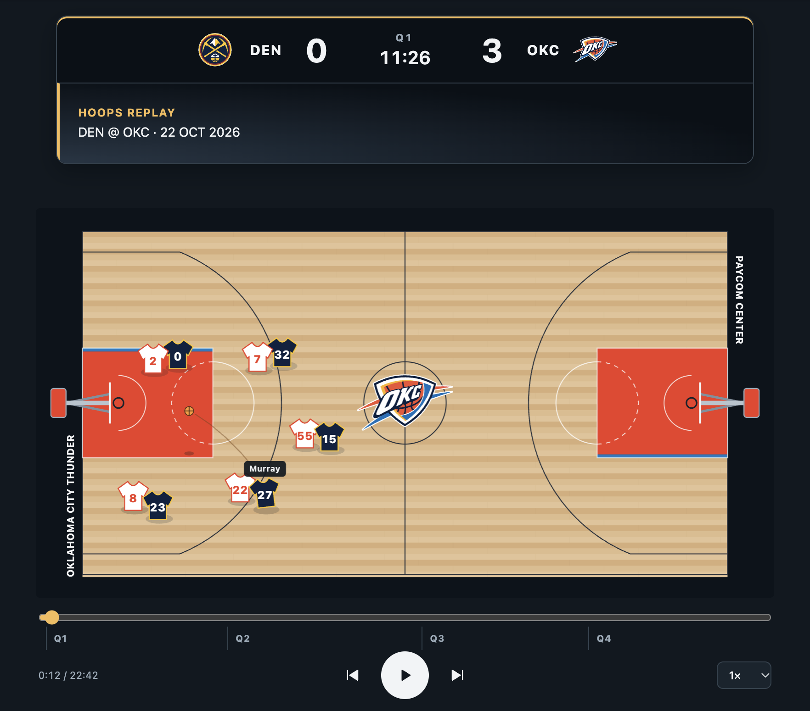

# Hoops Replay



Watch completed NBA and WNBA games play out as little jerseys move around a basketball court. Hoops Replay
uses real play-by-play events and available shot coordinates to create a schematic replay of the game.

**This is a very early prototype.** Expect bugs, odd movements, and games that cannot be loaded yet.
The player movements are schematic estimates, not a reconstruction from tracking data.

---

## Try It Out

Open [TOR at WAS in Hoops Replay](https://tehes.github.io/hoops-replay/?game=0022600097)
to try a completed NBA game directly in your browser.
For a WNBA example, open [Golden State at Atlanta](https://tehes.github.io/hoops-replay/?game=1042600304).

Without a Game ID in the URL, the app opens the bundled DEN–OKC example.

---

## Features

- **NBA and WNBA:** League detection from the Game ID, with league-specific team names, colors, logos,
  quarter lengths (NBA: 12 minutes; WNBA: 10 minutes), and three-point lines.
- **Full-court replay:** Follow both teams as numbered jerseys on a court with the home team's logo and colors.
- **Team colors and jerseys:** Automatic jersey selection balances team colors, clear separation, and readable numbers.
- **Coordinated movement:** Players advance together during inbounds and possession changes. Shooters move into
  receiving positions during the buildup, with travel time based on route length and the available time budget.
- **Play-by-play display:** See the score, game clock, player photos, and original event descriptions.
- **Different shot animations:** Dunks, layups, jump shots, and other finishes have different movements and ball flights.
- **Shot markers:** Made shots appear as green dots; misses appear as red crosses. Markers fade with replay time.
- **Playback controls:** Pause, change speed, scrub the timeline, or jump between quarters and possessions.
- **Load other games:** Use a completed NBA or WNBA game's ID in the URL to request its replay.

---

## How to Use

1. Open a replay and press **Play**.
2. Use the speed selector to slow down or speed up playback (0.5×, 1×, 1.5×, 2× or 4×).
3. Drag the timeline to any point, select a quarter, or use the previous/next buttons to move between possessions.
4. Tap or click a jersey to show the player's name.

On a keyboard, **Space** toggles playback and the **left/right arrow keys** move between possessions.
Pressing Play at the end restarts the replay.

### Load Another Game

1. Open a completed game's match page on [NBA.com](https://www.nba.com/games)
   or [WNBA.com](https://www.wnba.com/schedule).
2. Find the ten-digit number in the match URL. For example:

   ```text
   https://www.nba.com/game/phi-vs-nyk-0022600002
                                    ^^^^^^^^^^
                                    Game ID
   ```

3. Copy `0022600002`, including the leading zeros.
4. In the Hoops Replay link, replace the number after `?game=` with that Game ID:
   [https://tehes.github.io/hoops-replay/?game=0022600002](https://tehes.github.io/hoops-replay/?game=0022600002)

The replay detects the league from the Game ID: IDs starting with `10` use WNBA feeds;
other IDs use NBA feeds. For example, `?game=1042600304` loads the WNBA game above.
No additional league parameter, download, or command-line import is needed.
If your link already contains a `game` value, replace it rather than adding a second one.

### Jump to an Action

Add `&action=ACTION_NUMBER` to a game link to open the replay paused at that event, for example:
[DEN at OKC, action 17](https://tehes.github.io/hoops-replay/?game=0022600007&action=17).
Press **Play** to continue from there.
The link starts at the event itself. Scrub back a few seconds before pressing Play to watch its buildup.

The number is the event's `actionNumber` from the NBA or WNBA play-by-play data (also stored in local
`data/replay-<gameId>.json` snapshots). It is an event ID, not its position in the event list,
a quarter, or a replay timestamp. Include `game` when sharing links to identify the correct game.
For the bundled default game, `?action=17` works without a `game` parameter.

Events combined into one replay scene, such as a shot and its block or simultaneous substitutions,
jump to the same scene's event time; the display shows the main event's description.
An invalid or unknown action number leaves the replay at the beginning and logs a console warning.

---

## How It Works & Limitations

Play-by-play supplies the events, their order, scores, and involved players. Recorded shot coordinates
anchor field goals; boxscore data supplies players and starting lineups. The replay adds schematic
formations, defensive matchups, passes, rebounds, and running paths to connect the events.
Defensive assignments remain stable within an attack and follow substitutions. Where suitable, the buildup
includes short dribble routes or connecting passes. These are schematic additions, not recorded pass
sequences or evidence of a specific play. For a shot directly following an offensive rebound, an eligible
next shooter can move toward the receiving position during the preceding action.

- **Schematic movement:** Player locations between recorded events are estimates. The replay does
  not show the ten players' actual positions or claim to reproduce specific plays without evidence.
- **Condensed time:** Even at 1×, playback is not real time. Gaps between recorded game-clock times guide
  the buildup, and the displayed clock reaches each recorded event time. Players can move simultaneously;
  long routes can extend a scene when the condensed budget is too short. Shot flights keep their own timing.
- **Completed games only:** There is no live replay mode. A game must have compatible, consistent
  play-by-play and boxscore feeds. Invalid or unsupported games show an error instead of a substitute game.
- **Team colors:** Courts use fixed home-team palettes. Jerseys normally show home in white and away in primary.
  Color conflicts can switch home to primary and away to white or black, with contrasting trim and numbers.
  Team colors are preferred; neutral details are used when needed for readability. These are replay conventions,
  not the game's actual court design or uniform selection.
- **Network access:** Loading a game by ID and displaying NBA or WNBA player photos require a connection.
  There is no Service Worker or offline caching.
- **Overtime:** Five-minute overtime periods and quarter controls are implemented and covered by
  synthetic tests; a real overtime game has not yet been verified.

---

## For Developers

Built with vanilla HTML, CSS, and JavaScript modules. No dependencies, frameworks, or build step.
Deno is used for the optional import and verification tools; the frontend runs in the browser.
Read [PROJECT.md](PROJECT.md) for product decisions, the data contract and implementation limits,
and [AGENTS.md](AGENTS.md) for repository working rules.

### Run Locally

Use the project's existing local preview and open the replay in the browser.
The page needs to be served over HTTP rather than opened directly as a file.

For changes to a specific sequence, use action links in the local preview to reproduce and inspect
the relevant situation. For example, `?action=95` and `?action=566` select two movement examples in
the bundled DEN–OKC game. Scrub back before the event to watch the buildup, then check playback,
pause and repeated seeking. Use `?game=GAME_ID&action=ACTION_NUMBER` for another game.
Include the relevant local action links when presenting a change so its behavior can be reviewed directly.

### Project Structure

```text
├── index.html               # Court, scoreboard, and playback controls
├── css/style.css            # Base styles and replay layout
├── js/
│   ├── app.js               # Application entry point, rendering, and playback
│   ├── replay-engine.js     # Scenes, lineups, possession, and movement planning
│   ├── replay-shots.js      # Shot profiles and ball trajectories
│   ├── replay-teams.js      # NBA/WNBA team names, color palettes, and logos
│   ├── replay-colors.js     # Color similarity, contrast, and jersey selection
│   ├── replay-leagues.js    # League detection, quarter lengths, and three-point geometry
│   ├── replay-data.js       # Feed loading and normalization
│   └── replay-validation.js # Shared replay checks
├── data/                    # Reference snapshots and archived raw feeds
├── scripts/                 # Deno import and verification tools
├── img/                     # Demo image and local team logos
└── icons/                   # Application icon
```

All runtime paths are relative, including under a GitHub Pages repository path.
Umami page-view tracking is limited to `tehes.github.io`; localhost previews are excluded.

### Jersey Color Rules

All 30 NBA and 15 WNBA teams have local logos and primary colors adapted from
[NBA-Spielplan](https://github.com/Tehes/nba-spielplan). Optional alternate colors follow the same palette,
with cream for the Bucks and black available implicitly. The active values live in `js/replay-teams.js`;
they are replay display colors and do not depend on a particular season's uniform rotation.

- Normally, home wears white and away wears primary. Only similar primaries switch home to primary.
  Similarity follows the schedule's OKLab rule: less than 45° hue separation for chromatic colors;
  less than 0.30 lightness separation when either color's chroma is below 0.04.
- When home switches, away evaluates **alternate, white, and black**. Away primary is excluded because
  it conflicts with home paint. Bases qualify if they improve separation from home primary by at least 0.04 OKLab
  distance for chromatic primary pairs, or 0.5 contrast-ratio points for neutral pairs, as in the schedule.
  There is **no fixed minimum contrast between jersey or paint colors**.
- Trim and numbers must reach at least **4:1** against their own jersey. On white or black jerseys,
  primary and alternate compete for details; neutral details keep numbers readable if neither qualifies.
  Colored jerseys use white or black details. Variants retaining a team color in their base or details are preferred.
- Among eligible away variants, the higher number contrast wins, then higher jersey contrast against
  home primary. Final ties keep the order alternate, white, black.

Selection runs once when a game loads and stays consistent during playback, seeking, and side changes.
Court colors and logos stay with the home team. Regression tests cover all **1,080** ordered matchups
within the two leagues, including alternate jerseys, exclusion of conflicting away primary, and readable details.

### Import a Regression Fixture

The optional importer archives a completed game for repeatable local checks. Replace `GAME_ID`
with its ten-digit NBA or WNBA ID; the importer detects the league automatically:

```sh
deno run --allow-net=nba-spielplan.tehes.deno.net --allow-read --allow-write=data scripts/import-game.js GAME_ID
```

It saves the raw feeds under `data/raw/` and writes a playable `data/replay-GAME_ID.json` only after
validation succeeds. Existing files are preserved unless `--overwrite` is explicitly passed.
Loading `?game=GAME_ID` still requests backend data, even when a local fixture exists.
Raw feeds are saved before validation, so a failed import can leave raw archives without a playable snapshot.

### Reference Games

Five playable snapshots are included for repeatable regression checks:

| Game ID | League | Matchup | Final score (away–home) |
| --- | --- | --- | --- |
| `0022600007` | NBA | DEN at OKC | 84–96 |
| `0022600008` | NBA | NYK at BOS | 103–107 |
| `0022600094` | NBA | ATL at CHA | 128–81 |
| `0022600105` | NBA | BKN at CLE | 121–125 |
| `1042600304` | WNBA | GSV at ATL | 67–62 |

Only DEN–OKC is selected locally by default. Explicit `?game=` links request the backend.
Files under `data/raw/` also include unsupported or inconsistent cases; their presence does not mean
that a game passed validation.

### Development Checks

```sh
deno fmt --check js/ scripts/ css/style.css index.html
deno check js/*.js scripts/*.js
deno lint js/ scripts/
deno test --allow-read=data scripts/replay-data_test.js
deno test scripts/replay-colors_test.js
deno run --allow-read=data scripts/audit-replays.js
git diff --check
```

The audit discovers all local replay snapshots and checks scores, lineups, ball ownership, coordinates,
interpolation, and shot behavior. Raw archives are excluded.
The regression tests also cover simultaneous buildup, travel speed, early shooter positioning,
passes, rebounds, substitutions, synthetic overtime cases, and WNBA feed routing, team metadata,
ten-minute quarters, and three-point geometry.

For a browser check, load a game, play and pause, scrub across halftime, and seek to the final score.
Check the controls and court on both mobile and desktop widths.

---

## License & Credits

The code is source-available under the MIT License with the Commons Clause condition.
See [LICENSE.txt](LICENSE.txt) for the terms.

NBA and WNBA game data, team names, logos, and player photos belong to their respective owners.
Player photos load from the respective league's CDN; team logos are stored locally.
Hoops Replay is an independent, unofficial project.
